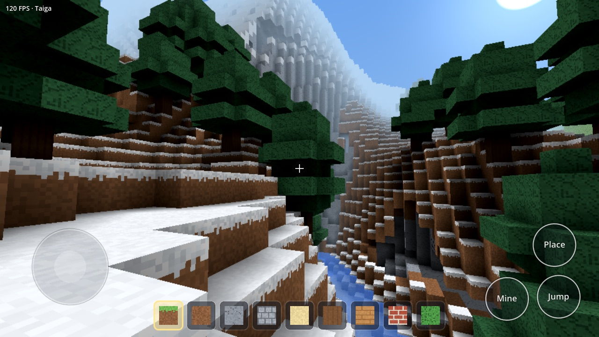
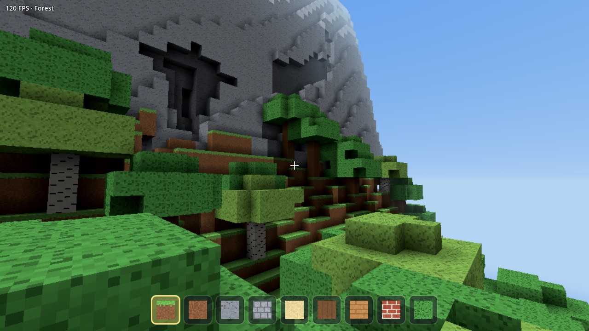
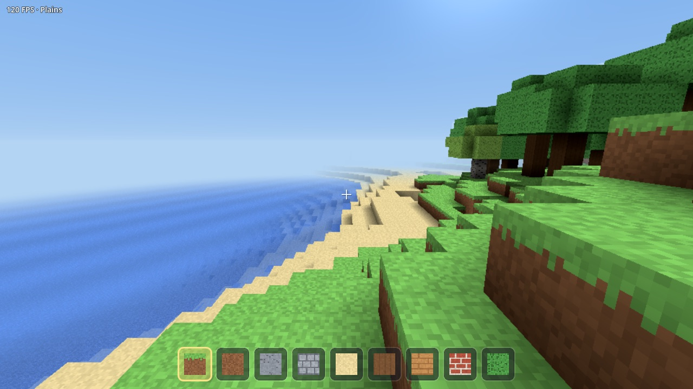
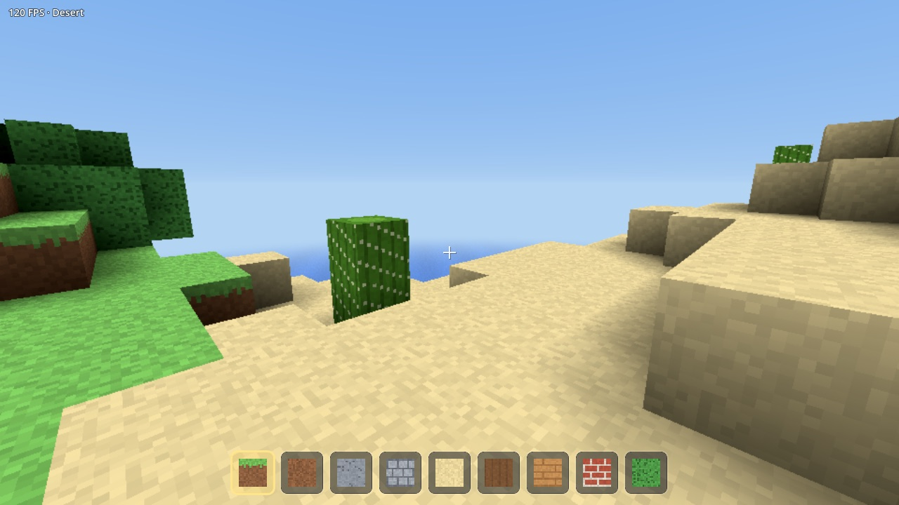
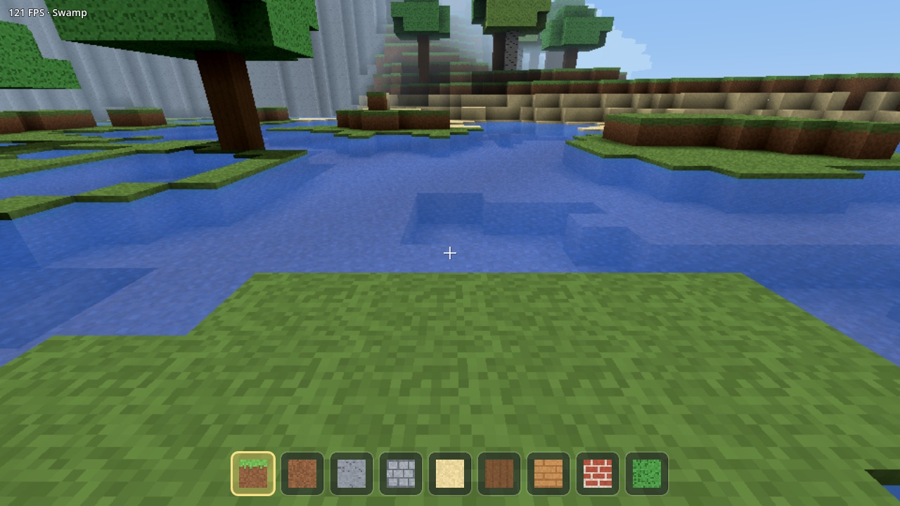
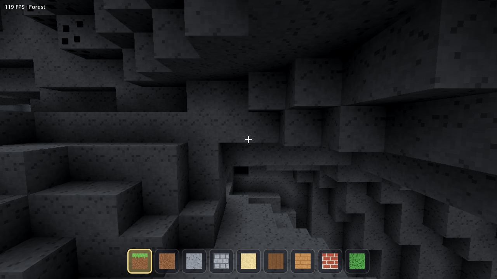
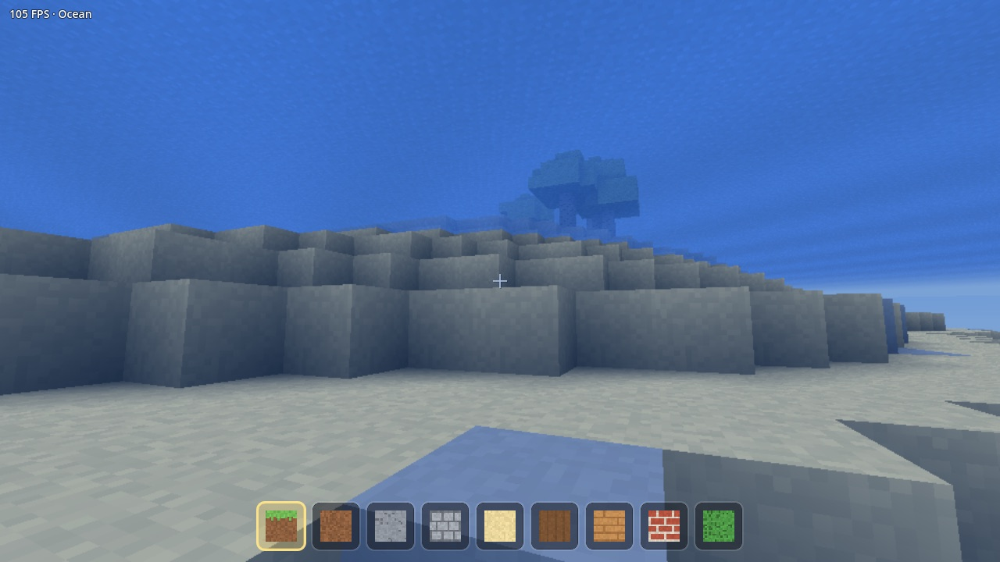
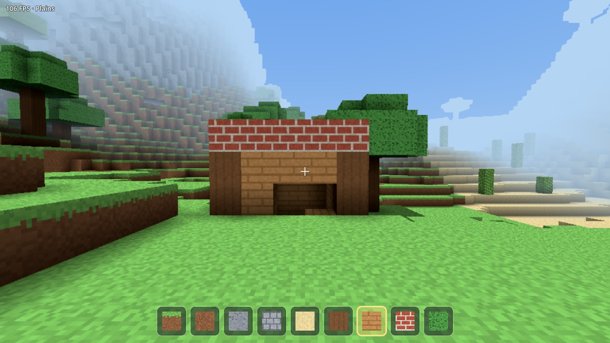
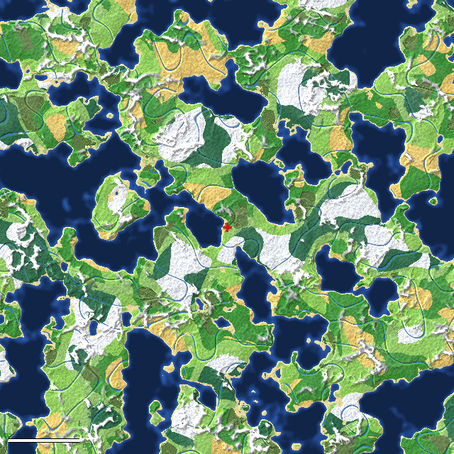

# VibeGameOne

A first-person voxel sandbox for mobile, built with Godot 4.7 (GDScript, Compatibility renderer). Explore a procedurally generated world of mountains, forests, deserts, swamps, oceans and caves, then mine and place blocks. Everything is tuned to be light on the GPU.



## Screenshots

All screenshots are taken from the running game (seed 1337, 1280×720, desktop). See [Reproducing the screenshots](#reproducing-the-screenshots) for the exact commands.

| | |
|---|---|
|  |  |
| **Mountains:** forest at the foot of a stone mountain, with a spaghetti-cave mouth opening on the cliff. | **Coast:** plains slope down to a beach and the ocean. |
|  |  |
| **Desert:** sand over sandstone, with cacti. | **Swamp:** flattened to the waterline, so it forms shallow pools between grassy hummocks. |
|  |  |
| **Caves:** winding tunnels under the surface, darker than the sunlit world. | **Underwater:** translucent water, a blue tint when your head is under the surface, and swimming. |
|  |  |
| **Building:** a hut made from hotbar blocks (cobblestone, oak log, planks, bricks). For the screenshot it is placed by `--demo=build`; in the game you place each block by hand. | **World map:** 3.2 × 3.2 km rendered by `tools/world_map.gd`, hill-shaded by height. The red cross is the origin and the bar is 500 blocks. |

## Running

```bash
godot --path .                               # play (mouse + keyboard)
godot --path . -- --touch-ui                 # try the touch controls with the mouse (one finger)
godot --path . -- --view=3 --scale=0.6       # simulate a low-end device
godot --path . -- --seed=42 --biome=DESERT   # another seed, spawn in a given biome
godot --path . -e                            # open the editor
godot --headless --path . -s res://tests/run_tests.gd   # run the tests
godot --headless --path . -s res://tools/world_map.gd -- --out=map.png --seed=1337   # top-down map
```

**Desktop controls**

| Action | Input |
|---|---|
| Lock / release the mouse | Click / Esc |
| Move | WASD |
| Jump (hold to swim up) | Space |
| Mine | Hold left mouse button |
| Place | Right mouse button |
| Pick a block | Mouse wheel or keys 1–9 |

**Mobile controls**

- Drag on the left half of the screen to move.
- Drag on the right half to look around.
- Hold **Mine** to dig a block. You can keep dragging while holding it to aim.
- Tap **Place** to put down the selected block.
- Tap **Jump**, or hold it to swim up.
- Walking into a one-block step jumps automatically.
- In water, swimming into a bank climbs out onto land.

### Command-line options

Pass these after `--`:

| Option | Effect |
|---|---|
| `--seed=<n>` | World seed (default 1337) |
| `--biome=<NAME>` | Spawn in the nearest biome of that name, e.g. `DESERT`, `SWAMP`, `SNOWY_PEAKS` |
| `--view=<n>` | View radius in chunks (default 4) |
| `--scale=<f>` | 3D render scale (default 0.75) |
| `--touch-ui` | Show the touch controls on desktop |
| `--pos=<x,y,z>` | Spawn at an exact position, for example inside a cave |
| `--look=<yaw,pitch>` | Initial camera angles, in degrees |
| `--demo=build` | Place a small hut in front of the player |
| `--screenshot=<path>` | Wait for the world to load, save a PNG, then quit |

## Project layout

| File | Role |
|---|---|
| `scripts/blocks.gd` | 25 block types. Builds the 8×8 texture atlas in code, so there are no image files. Defines which blocks hide other faces, collide, and can be targeted. |
| `scripts/terrain_gen.gd` | World generation (see below). Pure functions, so it runs on worker threads. |
| `scripts/chunk_mesher.gd` | Meshes 16×96×16 chunks. Culls hidden faces, adds vertex AO, darkens caves, and builds water as a separate mesh. |
| `scripts/world.gd` | Loads and unloads chunks around the player. Generation and meshing run on the WorkerThreadPool. Also does block raycasts. |
| `scripts/player.gd` | First-person player with direct AABB collision against the block grid, plus swimming. |
| `scripts/touch_controls.gd` | Joystick, drag-to-look and buttons. Each finger is tracked separately. |
| `scripts/hud.gd` | Hotbar, crosshair, mining progress ring, biome name and the underwater tint. |
| `shaders/voxel.gdshader` | Unshaded: one texture read plus fog. |
| `shaders/water.gdshader` | Translucent water: one texture read plus fog, no screen-texture reads. |
| `shaders/sky.gdshader` | Gradient sky with a sun. |
| `tools/world_map.gd` | Renders the biome and height map to a PNG. |
| `tools/run_ios.sh` | Export, build, sign and install on an iPhone. |

## World generation

The approach follows modern voxel games: terrain shape and biomes come from several independent noise layers, so biome borders never show steps or cliffs.

1. **Low-frequency noise, normalised by quantiles.**
   - At start-up the generator takes 4096 samples of each noise and builds a quantile table from them.
   - The table maps every value to an even 0..1 spread. A threshold then means "x% of the world" instead of a guess about the noise distribution.
   - The noise layers:
     - *continentalness*: ocean, coast or inland
     - *erosion*: rugged or flat
     - *peaks & valleys*: ridged noise that forms the mountain ridges
     - *temperature* and *humidity*
     - *river*
2. **Height.**
   - Height = spline(continentalness) + spline(erosion) × spline(peaks), plus small detail.
   - Swamps are then flattened to around sea level, so they form shallow pools between mud hummocks.
   - Rivers cut channels below sea level and fade out as they climb into mountains.
   - Height does not depend on the biome.
3. **Biomes.**
   - There are 12: Ocean, Beach, Plains, Forest, Birch Forest, Desert, Taiga, Snowy Plains, Swamp, Mountains, Snowy Peaks and River.
   - The biome comes from height, temperature, humidity and slope. Temperature falls with altitude, so peaks get snow caps.
   - Steep cliffs show bare stone.
   - Each biome has its own surface layers, for example sand over sandstone, snowy grass, gravel on deep sea floors, and clay.
4. **"Spaghetti" caves.**
   - Two 3D noises are sampled on a coarse global lattice (every 4 blocks) and interpolated in between. A tunnel forms where both values are close to 0.
   - Measured over 40 chunks with seed 1337, caves fill about 5% of the volume under land, with 339 entrances open to the surface.
   - Caves never cut into or next to a column that holds water, so still water never floats in the air.
5. **Ores and trees.** Coal and iron come in veins. Each biome has its own trees: oak, birch, spruce or cactus.

The table shows the share of each biome, measured with seed 1337 by the `biome_variety` test.

| Biome | Share |
|---|---|
| Ocean | 34.5% |
| Forest | 13.6% |
| Plains | 10.3% |
| Desert | 7.4% |
| Snowy Plains | 6.3% |
| Taiga | 6.0% |
| Birch Forest | 5.9% |
| Beach | 5.4% |
| Swamp | 4.5% |
| Snowy Peaks | 2.6% |
| Mountains | 2.3% |
| River | 1.3% |

## Why it is light on the GPU

- Lighting is baked into vertex colours: face direction, AO and cave darkness. Shaders are unshaded, with no lights or shadows.
- Fog is computed per vertex and hides chunks that are still loading.
- The 3D scene renders at 75% resolution (`rendering/scaling_3d/scale`). The UI stays sharp.
- No MSAA, no post-processing, no blur. Mobile is capped at 60 FPS.
- View distance is set by `World.view_radius` (4 chunks by default). On weak devices use 3: `-- --view=3`.
- The game logs to `user://logs/godot.log`. Every 10 seconds it writes a `PERF` line with average FPS, worst frame time, chunk generation and meshing time, and the current biome.

On an iPhone with an A16 chip, standing still, the game runs at a steady 60 FPS. Generating a chunk takes about 3.9 ms and meshing one about 14.6 ms, both on worker threads.

## Running on iPhone

Requirements:

- Xcode
- An Apple ID signed in to Xcode (Settings → Accounts)
- An iPhone with Developer Mode enabled, connected to the Mac
- The Godot 4.7.2 iOS export template in `~/Library/Application Support/Godot/export_templates/4.7.2.stable/`

```bash
tools/run_ios.sh            # export the Xcode project, build, sign (Personal Team), install
tools/run_ios.sh --launch   # the same, then start the game
IOS_TEAM=<team id> tools/run_ios.sh   # sign with a different team
```

The first launch is blocked by iOS. To allow it, go to Settings → General → VPN & Device Management → Trust. A build signed with a Personal Team works for 7 days.

To pull the log from the device:

```bash
xcrun devicectl device copy from --device <UDID> --domain-type appDataContainer \
  --domain-identifier com.vibegame.gameCraft --source Documents/logs/godot.log --destination godot.log
```

## Android export

`export_presets.cfg` already includes an Android preset (arm64, immersive). Godot has found the Android SDK, JDK 17 and the debug keystore. The **Android 4.7.2 export template** is still missing.

To install it, open the editor, go to Manage Export Templates and click Download. It is about 1.3 GB and needs about 3 GB of free space. Then run:

```bash
mkdir -p build && godot --headless --path . --export-debug Android build/vibegameone.apk
```

The Android build has not been tried yet.

## Reproducing the screenshots

Each command saves one PNG once the world around the player has loaded, then quits. The README images were converted to JPG.

```bash
shot() { out=$1; shift; godot --path . --resolution 1280x720 -- "$@" --screenshot="$out"; }
shot hero.png       --touch-ui --pos=-1392,41,24 --look=23,4
shot mountains.png  --pos=-420,41,-1368 --look=135,4
shot coast.png      --biome=PLAINS
shot desert.png     --biome=DESERT
shot swamp.png      --pos=-770,33,1240 --look=0,-25
shot cave.png       --pos=-13,22,-92 --look=90,-5
shot underwater.png --pos=-792,28,-800 --look=113,6
shot building.png   --pos=-1392,41,-144 --look=90,-2 --demo=build
godot --headless --path . -s res://tools/world_map.gd -- --out=world_map.png --size=640 --scale=5
```

Run them one at a time. On macOS, several game windows open at once can stall in the background.
